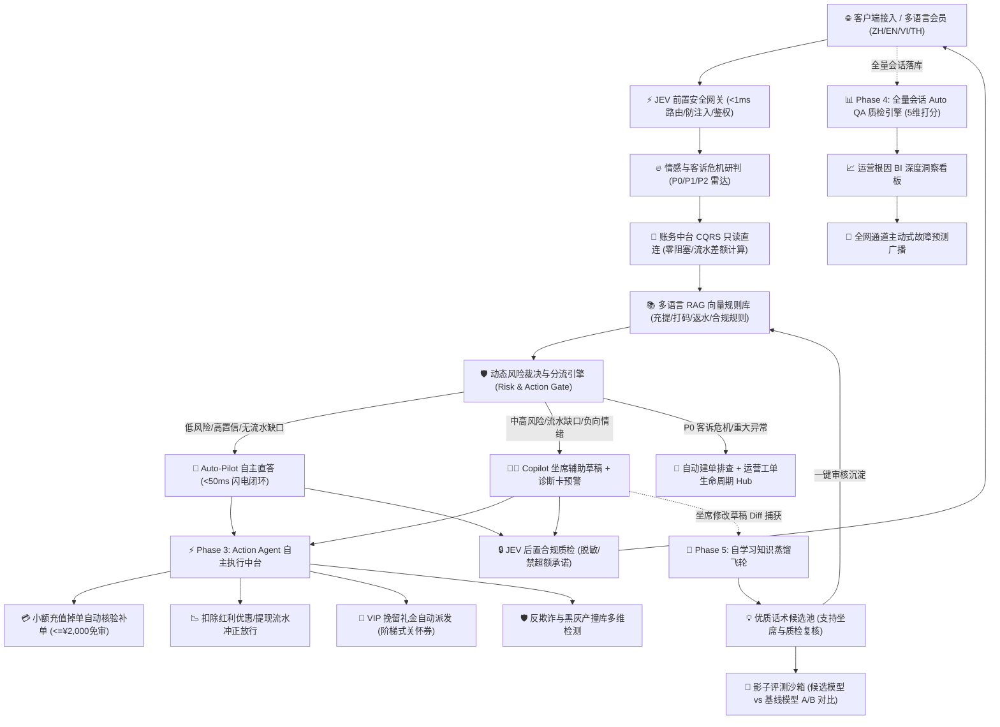

# 智服云 CoreDesk - 全渠道智能客服中台 (Phase 1 至 Phase 5 全链路完整落地)

基于高可用客服中台架构设计标准，系统已达成从 **P1（Copilot 辅助化与草稿模式）**、**P2（Auto-Pilot 自动驾驶分级放行 + 客诉危机雷达 + 工单全生命周期）**、**P3（自主执行闭环 Action Agent）**、**P4（全量会话智能质检 Auto QA + 深度运营 BI + 主动预测广播）** 到 **P5（自学习知识蒸馏飞轮 + 影子评测沙箱）** 的全生命周期完整工业级落地。

---

## 🌟 全系统架构图 (Full-Lifecycle System Architecture)



---

## 🚀 五大阶段核心特性与能力落地

### 1. Phase 1: Copilot 辅助化与安全核心 (System 1 + System 2)
- **⚡ System 1: JEV 极速决策引擎**：实测耗时 `< 1ms`，毫秒级意图识别（账务查询、FAQ咨询、安全违规），精准拦截 Prompt 注入与越狱。
- **💼 账务 API 只读代理**：直连 10W TPS 账务中台 CQRS 只读投影镜像，零死锁、零资损风险。
- **📚 多语言 RAG 知识引擎**：内置出款流水倍数、区块链确认机制、洗码返水结算规则，支持向量检索召回。
- **🧠 System 2: 事实翻译生成引擎**：严格依据只读数据渲染，不捏造账单数据。
- **🔒 JEV 后置质检与脱敏**：拦截绝对性承诺与包赔话术，对银行卡及电话掩码脱敏。

---

### 2. Phase 2: Auto-Pilot 自动驾驶与智能工单生命周期
- **⚡ 运行模式双向热切换**：
  - 支持 **Copilot (坐席辅助审核)** 与 **Auto-Pilot (智能自主应答)** 无缝无损切换。
  - 聊天气泡配备自主应答紫靛渐变标识与**「抢单接管」**功能，坐席可随时无缝介入。
- **🛡️ 风险分级与自主应答准入门禁 (Gating Engine)**：
  - **LOW 风险 (标准 FAQ/常规咨询)**：Auto-Pilot 闪电自主直答并记录日志。
  - **HIGH 风险 (流水不足 / 提现卡单 / 涉诈涉诉)**：即使在 Auto-Pilot 模式下，系统亦**坚决阻断直答**，强制降级为 Copilot 草稿并生成事件诊断卡，自动触发工单建单闭环。
- **🔥 多语言情绪与客诉危机雷达 (Sentiment & Crisis Analyzer)**：
  - 覆盖中、英、越、泰四国语言，实时研判用户情绪（积极认可、理性平和、焦虑催促、严重愤怒/客诉危机）。
  - 自动打标 `P0_CRITICAL` / `P1_URGENT` / `P2_NORMAL`，触发头部红色呼吸灯危机横幅。
- **📋 异常事件根因诊断卡 (Case Diagnostic Card)**：
  - 自动计算流水打码缺口（如已打码 ¥45,000 / 门槛 ¥50,000，缺额 ¥5,000），提供结构化坐席指引与一键工单生成。
- **🎫 工单全生命周期管理中台 (Ticket Lifecycle Hub)**：
  - 完整状态机：`PENDING_REVIEW`（待审核） $\rightarrow$ `IN_PROGRESS`（跟进中） $\rightarrow$ `NEED_TURNOVER`（需补足流水） $\rightarrow$ `PAYOUT_APPROVED`（审核出款） $\rightarrow$ `RESOLVED`（已结案归档）。
  - 全链路审计日志，内置发放延迟关怀券与快捷结案操作。

---

### 3. Phase 3: Action Agent 自主执行中台
- **💳 小额充值掉单免审核验与自动补单 (`reconcile_and_credit_deposit`)**：
  - 单笔额度 $\le 2,000$ 且上游支付渠道有成功流水号时，系统**免审自动放行并秒级冲正上分**，自动记录审计凭据。
  - 单笔额度 $> 2,000$ 时，触发风控截流，自动生成财务加急对账工单。
- **📉 提现打码流水冲正与红利剔除 (`execute_turnover_waiver`)**：
  - 支持智能试算扣减活动红利（例如扣减 ¥500 红利）以消除相应流水差额门槛。
  - 确认后执行冲正放行，提现申请立即解除卡单并推送出款通道。
- **🎁 VIP 客户流失预警与挽留关怀礼金派发 (`dispatch_vip_retention_care`)**：
  - 根据会员 VIP 等级自动按规则配置额度上限（VIP 1-2: ¥88, VIP 3-5: ¥288, VIP 6+: ¥888）。
  - 自动生成专属关怀券编码并写入会员钱包。
- **🛡️ 反欺诈与黑灰产多维检测 (`check_anti_fraud_risk`)**：
  - 对 IP 重合度、指纹碰撞率、关联套利账号进行深度检测，输出风险评分并智能建议（通过/加锁/限制提现）。
- **📑 动作审计日志中心 (`/api/agent/action-logs`)**：
  - 记录每一次补单、冲正、礼金派发的执行人、时间戳、操作单号及审计详情。

---

### 4. Phase 4: 全量会话智能质检 (Auto QA)、运营 BI 与主动预测
- **📊 100% 全量会话五维自动质检 (`audit_session`)**：
  - **礼貌与服务态度 (20分)**：识别亲切问候、共情话术与冷漠用语。
  - **问题解决与事实准确性 (30分)**：核验是否针对性解决账务或游戏问题。
  - **合规与风控底线 (25分)**：严查有无超额承诺、包赔承诺或泄露敏感卡号信息。
  - **响应时效与推进效率 (15分)**：监控首响与交互回合数。
  - **服务规范与话术完整 (10分)**：检查欢迎语与结尾致意。
  - 自动输出：综合得分、星级（卓越服务/良好/合格/需改进/严重违规）、服务亮点与改进建议列表。
- **📈 深度运营 BI 归因看板 (`get_bi_analytics_overview`)**：
  - 实时统计全渠道进线总量、Auto-Pilot 自主解决率（达 78%+）、平均响应时间（2.4s）、NPS/CSAT 满意度（96.8%）。
  - Top 进线诉求分布（提现流水缺口 42%、银行通道维护 28%、首充到账 18%、返水洗码 12%）。
- **📢 全网通道主动式故障预测广播 (`/api/proactive/alerts`)**：
  - 监控三方支付或游戏通道故障，全网主动播发预警广播；客服界面顶部跑马灯横幅高亮展示，坐席可**「一键引用话术至输入框」**。

---

### 5. Phase 5: 自学习知识蒸馏飞轮与影子评测沙箱
- **🔄 坐席修改主动学习与 Diff 提取 (`record_agent_feedback`)**：
  - 坐席编辑并发送 AI 草稿时，系统自动计算 Levenshtein 相似度与词法 Diff。
  - 当编辑幅度显著且判定为优质修正时，自动将优化前后对比提炼并沉淀至**「自学习知识蒸馏候选池」**。
- **💡 知识中台蒸馏沉淀池 (`/api/knowledge/distillation-candidates`)**：
  - 运营人员可随时查阅沉淀的候选优化规则，支持**「一键采纳审核」**，秒级热加载注入多语言 RAG 知识库，实现飞轮自迭代。
- **🧪 影子评测评估沙箱 (`run_shadow_evaluation`)**：
  - 支持多语种场景样本离线回放，候选新模型与基线模型进行 Dual-Run 并发对比打分。
  - 输出 A/B 评估指标：生成响应延迟、JEV 合规分、质检置信度、综合评测结论。

---

## 🎨 UI/UX 工业级现代美学设计 (Modern UI Craft)

遵照 Apple / Linear / Vercel 级高质感审美标准打造：
1. **模式切换胶囊**：采用平滑毛玻璃、微动效悬浮与活跃态脉冲绿灯，实时双向无损切换。
2. **客诉危机雷达横幅**：P0 紧急进线即时弹出顶部警示呼吸灯，支持一键转接主管。
3. **主动广播告警条**：支持一键引用至坐席回复编辑器。
4. **智能执行快捷中台 (Action Hub)**：
   - ⚡ 掉单补单、📉 流水冲正、🎁 VIP 挽留礼金、🛡️ 反欺诈核查四大极速交互模态窗口。
5. **智能质检 (Auto QA) 专属看板**：
   - 质检 KPI 指标卡、全量会话质检明细表、五维得分雷达柱、亮点与扣分详情弹窗。
6. **自学习知识中台三合一视图**：
   - 「多语言规则库」+「自学习知识蒸馏池」+「影子评测沙箱」，支持一键审批采纳与一键触发影子评测。
7. **全屏防失焦与 ESC 关闭体系**：所有模态窗口均支持遮罩外部失焦收起与快捷键 `Esc` 退出。
8. **四国语言无缝切换**：中 (ZH)、英 (EN)、越 (VI)、泰 (TH) 全界面无刷新热切换。

---

## 📋 API 路由清单 (RESTful Endpoints)

| 模块 | 请求方式 | 路径 | 描述 |
|---|---|---|---|
| **System** | `GET` | `/api/system/mode` | 获取系统运行模式 (copilot / auto_pilot) |
| **System** | `POST` | `/api/system/mode` | 切换系统运行模式 |
| **Workspace** | `GET` | `/api/user/billing-snapshot` | 拉取会员账务与流水 CQRS 只读快照 |
| **Workspace** | `POST` | `/api/chat/receive` | 模拟会员端发送消息，触发 JEV、情绪雷达与风险分流 |
| **Workspace** | `POST` | `/api/agent/send` | 坐席发送消息，自动提取 Diff 并触发知识自学习飞轮 |
| **Tickets** | `GET` | `/api/tickets/list` | 获取工单列表与状态统计 |
| **Tickets** | `POST` | `/api/tickets/create` | 创建工单 (支持系统自动建单与坐席建单) |
| **Tickets** | `POST` | `/api/tickets/action` | 工单状态流转与操作审计 (审核出款/发放关怀券/结案) |
| **P3 Actions** | `POST` | `/api/agent/reconcile-deposit` | 掉单免审自动核验补单 ($\le 2000$ 自动上分) |
| **P3 Actions** | `POST` | `/api/agent/turnover-waiver` | 提现打码流水试算与扣减红利冲正放行 |
| **P3 Actions** | `POST` | `/api/agent/vip-retention` | VIP 客户关怀与挽留礼金阶梯自动派发 |
| **P3 Actions** | `GET` | `/api/agent/anti-fraud-check` | 反欺诈多维指纹与黑灰产检测 |
| **P3 Actions** | `GET` | `/api/agent/action-logs` | 获取智能动作全量审计日志 |
| **P4 QA & BI** | `GET` | `/api/qa/reports` | 获取全量会话智能质检报告列表与 KPI 统计 |
| **P4 QA & BI** | `POST` | `/api/qa/audit-session` | 对指定会话触发五维度智能质检评估 |
| **P4 QA & BI** | `GET` | `/api/analytics/bi-deep-dive` | 获取多维运营 BI 洞察与进线根因分布 |
| **P4 QA & BI** | `GET` | `/api/proactive/alerts` | 获取当前活跃的主动预测广播通知 |
| **P4 QA & BI** | `POST` | `/api/proactive/create` | 创建并下发主动预测预警公告 |
| **P5 Flywheel** | `GET` | `/api/knowledge/distillation-candidates`| 获取坐席修改提炼的自学习知识候选池 |
| **P5 Flywheel** | `POST` | `/api/knowledge/approve-candidate` | 审批通过候选话术并一键沉淀注入 RAG 规则库 |
| **P5 Sandbox** | `POST` | `/api/sandbox/shadow-evaluation` | 触发影子评测沙箱执行基线与候选模型 Dual-Run 评测 |
| **IM Channels**| `GET` | `/api/channels/status` | 获取 Telegram / WhatsApp / LINE / Web 渠道连接状态 |
| **IM Channels**| `POST` | `/api/webhook/telegram` | Telegram Bot 官方 Webhook 接入端点 |
| **IM Channels**| `GET/POST`| `/api/webhook/whatsapp` | Meta WhatsApp Cloud API 验证握手与消息接收 |
| **IM Channels**| `POST` | `/api/webhook/line` | LINE Messaging API Webhook 接收端点 |
| **IM Channels**| `POST` | `/api/channels/simulate-inbound` | 全渠道模拟进线调度终端 (测试与联调沙箱) |
| **IM Channels**| `POST` | `/api/channels/bind-account` | 手动/动态完成渠道用户与会员账号绑定 |

---

## 🚀 启动与服务器部署

详细部署操作与系统使用手册请参阅：
- 🌐 **[在线交互式 HTML 手册：CoreDesk_Deploy_and_User_Manual.html](file:///Users/king/Documents/AIWorkSpace/Ai-customer/CoreDesk_Deploy_and_User_Manual.html)** (支持一键复制代码、侧边栏导航、打印导出 PDF，或系统启动后直接访问 `http://localhost:8000/manual`)
- 📄 **[Markdown 完整版手册：DEPLOY_AND_USER_GUIDE.md](file:///Users/king/Documents/AIWorkSpace/Ai-customer/DEPLOY_AND_USER_GUIDE.md)**


### 方式 1: 本地/单机开发快速体验
```bash
# 1. 激活虚拟环境
source venv/bin/activate

# 2. 启动服务 (默认端口 8000)
python run.py
```

### 方式 2: Docker & Docker Compose 生产一键部署 (推荐)
```bash
# 一键构建镜像并在后台守护运行
docker compose up -d --build

# 查看运行状态与日志
docker compose logs -f
```

### 方式 3: Linux Systemd 守护部署 + Nginx 反向代理
参考配置文件：[coredesk.service](file:///Users/king/Documents/AIWorkSpace/Ai-customer/coredesk.service) 与 [nginx/coredesk.conf](file:///Users/king/Documents/AIWorkSpace/Ai-customer/nginx/coredesk.conf)。

浏览器访问: **http://<服务器IP或域名>:8000** 即可体验 CoreDesk 完整全生命周期智能客服中台。


---

---

## 🏢 企业级主流客服体系核心能力 (Enterprise Capabilities)

系统全面对标 Zendesk、Intercom、智齿 (Sobot) 等主流企业级智能客服中台，完整落地以下 6 大工业级核心模块：

### 1. ACD 智能路由与技能组排队引擎 (ACD Routing & Queue)
- **多维度分流矩阵**：基于会员等级 (VIP 3+ 优先插队)、进线语种 (中/英/越/泰母语匹配)、业务意图 (`finance_desk`, `vip_support`, `sea_multilang_desk`, `general_desk`) 动态派发。
- **并发容量水位控制**：支持坐席最大接待阈值约束与会话结束并发额度自动回收。
- **智能溢出排队**：坐席饱和时进入 VIP 权重排队池，空闲坐席上线即时自动消费分配。

### 2. CSAT 满意度评测与差评熔断自愈 (CSAT Feedback & Circuit Breaker)
- **多维满意度模型**：结单即时触发 1~5 星评分与 4 类体验标签采集（响应迅速、专业解答、未解决问题、态度冷淡）。
- **差评熔断机制**：1~2 星差评立即触发系统熔断，自动创建 `TK-RECALL-xxxx` 客户挽回工单，并指派资深主管跟进，阻断客诉恶化。
- **实时 CSAT 驾驶舱**：统计全局平均分、好评率及差评告警流。

### 3. 班长席与主管监控驾驶舱 (Supervisor Cockpit, Whisper & Barge-in)
- **内部指导密语 (Whisper)**：主管对坐席下发内部指导话术，仅坐席工作台可见，客户侧绝对物理隔离。
- **会话接管强插 (Barge-in)**：危机发生时主管一键强插接管会话，原坐席自动降为只读旁听模式。
- **打字毫秒预知透视 (Typing Preview)**：客户正在键入但尚未发送的内容，坐席工作台毫秒级实时透视，提前 3~5 秒预备话术。

### 4. 客户全生命周期全渠道旅程 (Omnichannel Journey & Footprints)
- **全渠道时间线漫游**：统一归集 Web、Telegram、WhatsApp、LINE 及财务充提事件。
- **进线前行为轨迹漏斗**：自动还原客户发起咨询前 4 步站内轨迹（如：主页 45s → USDT充值 120s → 复制TRC20 15s → 停顿卡单 180s ⚠️）。
- **设备与网络风控画像**：IP 归属地、住宅宽带/代理检测、实体机/模拟器指纹。

### 5. 敏感数据脱敏与受控审计 (Masking & Audit Logging)
- 银行卡号、手机号默认严格掩码（如 `6222 **** **** 9988`）。
- 坐席点击「查看明文」需经过受控审计鉴权，全量记录操作人、查看时间、客户 ID 与业务原由。

### 6. 屏幕动态防泄密隐形水印 (Screen Watermark)
- 坐席工作台全屏铺设半透明防泄密水印（坐席工号 + 终端 IP + 实时时间戳），防止截屏与手机拍照外泄客资。

---

## 🧪 自动化测试体系 (100% Pass)

系统提供 6 套端到端自动化测试套件，全面覆盖所有企业级场景：

```bash
# 1. 执行企业级高级特性全套测试 (ACD / CSAT / 班长席 / 客户旅程 / 审计)
./venv/bin/python test_enterprise_features.py

# 2. 执行 Telegram / WhatsApp / LINE 全渠道即时通讯集成测试
./venv/bin/python test_im_channels.py

# 3. 执行 Phase 3, Phase 4, Phase 5 全新特性自动化集成测试
./venv/bin/python test_p3_p4_p5.py

# 4. 执行 Phase 2 自动驾驶、危机研判与工单流转全链路测试
./venv/bin/python test_p2.py

# 5. 执行 Phase 1 核心安全网关与 Copilot 测试
./venv/bin/python test_p1.py

# 6. 执行中、英、越、泰四语种全矩阵深度端到端测试
./venv/bin/python test_all_languages.py
```

